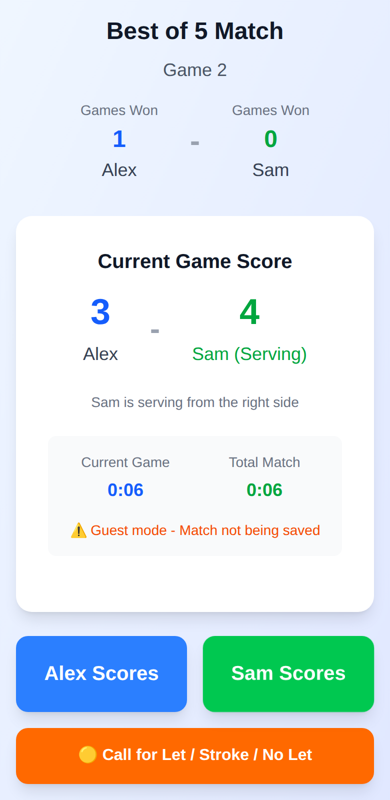
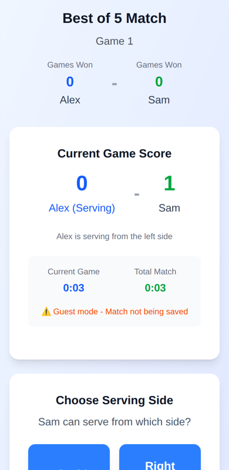
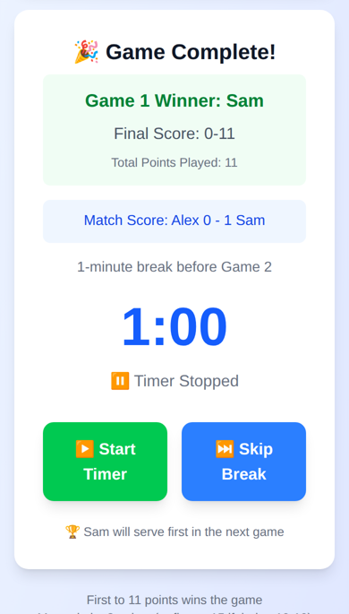

# Squash Referee

[](https://github.com/Tarmk/SquashRef/actions/workflows/ci.yml)

[](LICENSE)

A match-support app for squash referees: score a match rally by rally, keep the server and serving side straight, run the warm-up and between-game timers, and print a full transcript at the end. It is built for refereeing real matches from a phone or tablet at the side of the court.

**Live:** https://squash-ref.vercel.app

<table>
  <tr>
    <td></td>
    <td></td>
    <td></td>
  </tr>
  <tr>
    <td align="center">One tap per rally</td>
    <td align="center">Hand-out: new server picks a side</td>
    <td align="center">Game over, break timer</td>
  </tr>
</table>

## What it does

- **Live scoring.** One tap per rally. The app tracks the score, who serves, and which side they serve from: the server switches sides while they keep winning, and after a hand-out the new server picks a side.
- **Let / stroke / no let.** Decisions are logged in the transcript. A stroke counts as a rally won, so it can cause a hand-out or end a game like any other rally.
- **Warm-up and breaks.** A 5-minute warm-up timer (with the side switch at 2:30) and the 60-second break between games.
- **Transcripts.** Every rally of every game, with server, side and decisions, printable per game or for the whole match.
- **Accounts.** Sign in with email and password and matches save to your dashboard; without an account everything works in guest mode.
- **Tournaments.** Create a round-robin or Monrad tournament, publish it, and share a join link or QR code. Players sign in and register themselves (capacity and duplicate checks are enforced by the database rules, not just the page); the host sees the list, can add walk-ins by name and remove anyone. Private tournaments are only reachable through the link.

Scoring follows point-a-rally to 11, win by two, best of 3 or 5 games. At 10-10 the referee chooses on the match format screen: play on until someone leads by two (the WSF/PSA rule, the default) or first to 15, which some club events use to keep to time. The choice is saved with the match and shown in its transcript.

## How it is built

Next.js (App Router), React 19, TypeScript, Tailwind CSS, Firebase Auth and Firestore, deployed on Vercel.

- [`src/lib/scoring.ts`](src/lib/scoring.ts): the rules as pure functions (`playRally`, `isGameWon`, ...). The scoring screen calls these instead of re-implementing the rules inline.
- [`src/lib/schedule.ts`](src/lib/schedule.ts): round-robin schedules with the circle method (nobody plays twice in one round, byes for odd numbers) and the first Monrad round.
- [`hooks/useMatchPersistence.ts`](hooks/useMatchPersistence.ts): saves a signed-in referee's match to Firestore every 30 seconds and after every game, and marks it complete once.
- [`src/lib/tournamentService.ts`](src/lib/tournamentService.ts): tournaments and player registration. Each player is one document in `tournaments/{id}/players/{userId}`, written in the same batch as the tournament's `playerCount`.
- [`firestore.rules`](firestore.rules): referees only see their own matches; only the host edits a tournament; a player can only add or remove themselves, only while registration is open and there is room, and only together with a one-step change to `playerCount`. Tested against the Firestore emulator in [`rules/`](rules/firestore.rules.test.ts).

## Running it locally

```bash
npm install
npm run dev        # http://localhost:3000
```

Without Firebase config the app runs in guest mode. To save matches, create a Firebase project with Email/Password sign-in and Firestore, then put its web config in `.env.local` (`cp .env.example .env.local`):

```
NEXT_PUBLIC_FIREBASE_API_KEY=
NEXT_PUBLIC_FIREBASE_AUTH_DOMAIN=
NEXT_PUBLIC_FIREBASE_PROJECT_ID=
NEXT_PUBLIC_FIREBASE_STORAGE_BUCKET=
NEXT_PUBLIC_FIREBASE_MESSAGING_SENDER_ID=
NEXT_PUBLIC_FIREBASE_APP_ID=
```

Deploy the security rules with `npx firebase deploy --only firestore:rules` (the project is set in `.firebaserc`), or paste `firestore.rules` into the Firebase console.

To work without a Firebase project at all, run against the local emulators (needs Java 11 or newer):

```bash
npm run dev:emulators   # Auth + Firestore emulators and the app, with the config in .env.emulators
```

## Checks

```bash
npm run lint
npm run typecheck
npm test           # Vitest: scoring rules, schedules, registration helpers, redirects
npm run test:rules # Firestore security rules in the emulator (needs Java)
npm run build
```

CI runs all of them on every push.

## Background

I played and refereed squash for years and kept seeing referees score on paper or in a notes app. This started as a tool for myself and grew into something other referees at my club could use. A separate, more fully featured version (SquashRef Pro) exists for my school's tournaments.

## License

MIT, see [LICENSE](LICENSE).
